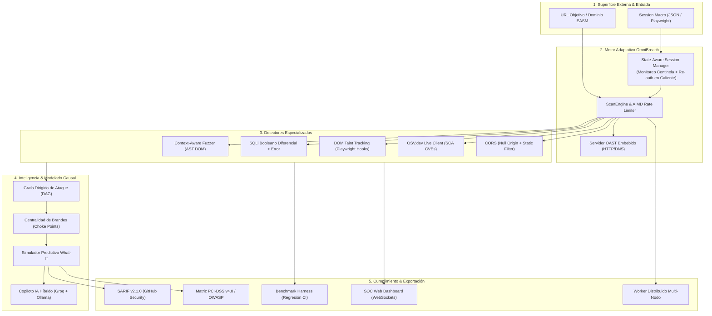

# OmniBreach v3.10 — DAST, EASM & ASPM Security Scanner

<p align="center">
  
</p>

<p align="center">
  <a href="https://github.com/papiwilo74/vulnscanner-v1/releases/tag/v3.10"></a>
  <a href="https://github.com/papiwilo74/vulnscanner-v1/actions"></a>
  <a href="https://mypy-lang.org/"></a>
  <a href="https://github.com/PyCQA/bandit"></a>
  <a href="https://osv.dev/"></a>
  <a href="https://www.cisa.gov/known-exploited-vulnerabilities-catalog"></a>
  <a href="https://docs.oasis-open.org/sarif/sarif/v2.1.0/sarif-v2.1.0.html"></a>
  <a href="reports/scientific_benchmark_report.md"></a>
  <a href="tests/"></a>
  <a href="LICENSE"></a>
  <a href="https://www.python.org/"></a>
</p>

> **OmniBreach v3.10** es una plataforma integral de **Next-Gen DAST, EASM y ASPM (Application Security Posture Management)** diseñada para auditorías de alta velocidad, integración en CI/CD y trazabilidad forense:
> - **Motor Declarativo de Plantillas YAML/JSON (DSL)**: Ejecución de reglas personalizables con multi-matchers, condiciones lógicas y extractores encadenados.
> - **Pipeline Reactivo y 100% Asíncrono (AsyncIO + Streaming)**: Colas no bloqueantes con control de congestión adaptativo tipo TCP (AIMD).
> - **Middleware IAST / RASP Plug-and-Play (ASGI + WSGI)**: Telemetría en tiempo de ejecución, hooks en sinks críticas (`eval`, `subprocess`, `os.system`) y correlación DAST+IAST con archivo y línea de código exacta.
> - **Escaneo Quirúrgico por Git-Diff en CI/CD (<30s)**: Análisis incremental de endpoints afectados, Quality Gates configurables y bot de comentarios en Pull Requests.
> - **Active Monkey Testing & CDP Network Interception**: Exploración dinámica de SPAs (React/Vue/Angular), mutaciones de DOM y captura profunda de llamadas XHR/Fetch/WebSockets.
> - **Servidor OAST Dedicado (RFC 1035 UDP + HTTP)**: Detección fuera de banda de vulnerabilidades ciegas (Blind SSRF, Blind XXE, Blind RCE y Log4j).
> - **Gestión de Autenticación Compleja & MFA/TOTP (RFC 6238)**: Inyección dinámica de tokens temporales de un solo uso en flujos Playwright y SPAs.
> - **Supresión Avanzada de Falsos Positivos**: Proof-Based Verification (PBV), filtro anti-Soft-404, WAF Block Suppression y Entropía de Shannon.
> - **Cumplimiento y DevSecOps**: Exportador oficial **OASIS SARIF v2.1.0**, GitHub Action nativa (`action.yml`) y matriz de cumplimiento **PCI-DSS v4.0 / NIST / ISO 27001**.

> **Alcance:** las métricas, benchmarks y detectores incluidos son experimentales y dependen del objetivo, el entorno y los casos de prueba. Las cifras de precisión no deben interpretarse como garantías universales de detección.

---

## Tabla de Contenidos

- [Arquitectura General](#arquitectura-general)
- [Los 11 Pilares Técnicos de OmniBreach (v3.10)](#los-11-pilares-tecnicos-de-omnibreach-v310)
- [Validación Empírica Cuantitativa (Juice Shop & PyGoat)](#validacion-empirica-cuantitativa-juice-shop--pygoat)
- [Instalación Rápida](#instalacion-rapida)
- [Guía de Uso CLI y Ejemplos](#guia-de-uso-cli-y-ejemplos)
- [Opciones de Configuración Avanzadas](#opciones-de-configuracion-avanzadas)
- [Calidad y Reproducibilidad (CI/CD)](#calidad-y-reproducibilidad-cicd)
- [Estructura del Proyecto](#estructura-del-proyecto)
- [Hoja de Ruta y Trabajo Futuro (Roadmap 2027)](#hoja-de-ruta-y-trabajo-futuro-roadmap-2027)
- [Ética y Uso Responsable](#etica-y-uso-responsable)
- [Licencia](#licencia)

---

## Arquitectura General



---

## Los 11 Pilares Técnicos de OmniBreach (v3.10)

### 1. Fuzzing Quirúrgico Contextual (AST DOM Analysis)
En lugar de disparar decenas de payloads a ciegas que saturan el WAF, OmniBreach envía una sonda benigna alfanumérica previa (`vScanProbe74`) y clasifica el punto de reflejo en el DOM:
* **`HTML_BODY`**: Genera `<script>alert(1)</script>` o `<svg onload=alert(1)>`.
* **`ATTR_VALUE`**: Genera rupturas de atributos (`" onfocus="alert(1)" autofocus="`).
* **`URI_ATTR`**: Genera esquemas `javascript:alert(1)`.
* **`SCRIPT_BLOCK`**: Rompe cadenas en JavaScript (`';alert(1)//`).
* **`HTML_COMMENT`**: Escapa comentarios (`--> <script>alert(1)</script>`).

### 2. State-Aware Sessions & Re-autenticación en Caliente
Resuelve el talón de Aquiles de los escáneres DAST en aplicaciones SaaS:
* Monitorea un endpoint centinela (`sentinel_url`, ej. `/api/me`).
* Si el token JWT expira o el servidor responde con `401 Unauthorized` o redirección a `/login`, **congela el escaneo de forma transparente, ejecuta el macro de autenticación (vía HTTP o Playwright)**, actualiza las cookies/tokens y reanuda el escaneo sin pérdida de datos.

### 3. SCA Dinámico con la API de OSV.dev (Google / OpenSSF)
* Conexión en tiempo real con `https://api.osv.dev/v1/query`.
* Detecta paquetes y librerías desactualizadas en frontend/backend, correlacionando con GHSAs y CVEs oficiales con puntuaciones CVSS.
* Implementa caché en memoria y **fallback automático a base local** para entornos sin conexión a internet.

### 4. Harness de Benchmarks y Detección de Regresión en CI/CD
* Orquesta pruebas contra **OWASP Juice Shop** y **OWASP PyGoat**, registrando Precision, Recall, F1, True Positives y False Positives en `reports/benchmark_juiceshop.json` y `reports/benchmark_pygoat.json`.
* **Guardián de Calidad**: Bloquea el pipeline de CI si un cambio de código reduce la precisión o incrementa los falsos positivos.
* Workflow nativo en GitHub Actions ([`.github/workflows/security_benchmark.yml`](.github/workflows/security_benchmark.yml)).

### 5. Detección Fuera de Banda (OAST) y Blind XXE
* Servidor HTTP y DNS (RFC 1035 UDP) multihilo embebido en segundo plano para auditorías en redes cerradas o aisladas.
* Genera DTDs y entidades externas asíncronas para confirmar vulnerabilidades ciegas que no devuelven datos en la respuesta HTTP inmediata.

### 6. DOM Taint Tracking & Active Monkey Crawler con Playwright CDP
* Inyección de arnés JavaScript previo a la carga (`page.add_init_script`) con hooks sobre sinks peligrosos (`eval`, `setTimeout`, `document.write`, `Element.innerHTML`).
* Interceptación de red vía Chrome DevTools Protocol (CDP) y simulación segura de eventos DOM para descubrir rutas SPA ocultas.

### 7. Modelado Causal de Amenazas y Choke Points (Brandes Centrality)
* Algoritmo determinista de Brandes ($O(|V| \cdot |E|)$) que identifica qué nodo de la red corta el mayor número de rutas de ataque críticas.
* Simulador predictivo **What-If** que calcula la reducción cuantitativa de riesgo ($\Delta\text{Risk}\%$) antes de parchar.

### 8. Cumplimiento Normativo, Virtual Patching y DevSecOps
* Mapeo contra **PCI-DSS v4.0** (Req 6.2.4, 6.4.1, 6.4.3, 8.3.1, 4.1.2), **OWASP Top 10 (2021)**, **ISO/IEC 27001:2022** y **NIST SP 800-53 Rev 5**.
* Síntesis automática de reglas WAF (**ModSecurity**, **AWS WAF**, **Cloudflare**, **Nginx**) y exportación oficial **SARIF v2.1.0**.

### 9. Copiloto IA Híbrido (Groq LPUs + Ollama Local GPU) & Auto-Fix
* **Arquitectura Híbrida**: Conmutación transparente entre inferencia ultra-rápida en la nube con LPUs (**Groq** con LLaMA 3.3 / Qwen) y privacidad total en hardware local (**Ollama** con GPU local sin fuga de datos sensibles).
* **5 Modos Operativos Especializados**: Explicación ejecutiva CISO, generación de parches de remediación, triaje de falsos positivos, modelado STRIDE/MITRE y Auto-Fix AST con backup `.bak`.

### 10. Hardening de Producción, RBAC Multi-Tenant & W3C CORS
* **Aislamiento Criptográfico**: Segregación estricta por Organización y Roles granulares (`ADMIN`, `AUDITOR`, `DEVELOPER`).
* **Bloqueo Incondicional en Producción (Fail-Closed Security)**: La plataforma rehúsa arrancar en producción si `OMNIBREACH_JWT_SECRET` o `OMNIBREACH_ADMIN_PASSWORD` no han sido provistos con suficiente entropía.

### 11. Arquitectura Modular Desacoplada y Persistencia Agnóstica (PostgreSQL Neon / SQLite)
* **Separación de Responsabilidades (SRP)**: CLI modularizado en `cli/` (`parser.py`, `dispatch.py`) y controladores REST desacoplados en `routers/` (`ci_cd.py`, `templates.py`, `crawler.py`, `proxy.py`).
* **Adaptador Universal de Base de Datos (`UniversalConnection`)**: Soporte nativo para PostgreSQL Serverless (**Neon**) con fallback transparente a SQLite.

---

## Validación Empírica Cuantitativa (Juice Shop & PyGoat)

Las mediciones del escáner se validan empíricamente contra aplicaciones vulnerables reales de la industria, reportando de forma transparente tanto los aciertos como los límites actuales de detección automática:

| Métrica de Rendimiento | OWASP PyGoat (Django/Python) | OWASP Juice Shop (Angular/Node) | Análisis de Ingeniería |
| :--- | :---: | :---: | :--- |
| **Precision** | **100.0%** (9 / 9) | **100.0%** (9 / 9) | **0 falsos positivos** tras confirmación diferencial y supresión de bloqueos WAF. |
| **Recall (Sensibilidad DAST)** | **69.2%** (9 / 13) | **64.3%** (9 / 14) | Detecta inyecciones, CORS, CSP, exposición de métricas/esquemas y Prototype Pollution. |
| **Falsos Negativos (FN)** | **4** | **5** | Retos de lógica de negocio multi-paso y manipulación semántica que requieren contexto humano. |
| **F1-Score** | **81.8%** | **78.3%** | Balance empírico verificable (ver [`reports/benchmark_juiceshop.json`](reports/benchmark_juiceshop.json)). |
| **False Positives (FP)** | **0** | **0** | Ausencia de alertas espurias en el conjunto evaluado. |

---

## Instalación Rápida

### Requisitos
* Python 3.10, 3.11 o 3.12
* Gestor de paquetes `pip`

```bash
# 1. Clonar el repositorio
git clone https://github.com/papiwilo74/vulnscanner-v1.git
cd vulnscanner-v1

# 2. Crear y activar entorno virtual
python -m venv venv

# Windows (PowerShell)
.\venv\Scripts\Activate.ps1

# Linux / macOS
source venv/bin/activate

# 3. Instalar dependencias completas
pip install -r requirements.txt
pip install -r requirements-dev.txt

# 4. (Opcional) Instalar navegadores para Playwright (DOM Taint & SPAs)
playwright install chromium
```

### Ejecución con Docker

```bash
# Iniciar API REST y Dashboard
docker compose up -d api

# Ejecutar escaneo rápido vía CLI en contenedor
docker compose --profile cli run --rm cli https://ejemplo.com/ --stealth
```

---

## Guía de Uso CLI y Ejemplos

### 1. Escaneo Básico
```bash
python main.py https://mi-aplicacion.com
```

### 2. Escaneo Autenticado con Macro de Sesión y Centinela en Caliente (v3.8)
```bash
python main.py https://portal.empresa.com \
  --session-macro auth_flow.json \
  --sentinel-url https://portal.empresa.com/api/v1/users/me
```

### 3. Auditoría de Superficie Externa (EASM) y Ransomware Scout
```bash
python main.py --easm mi-empresa.com
```

### 4. Modo Completo con Playwright, Fuzzing y Reporte PDF
```bash
python main.py https://mi-aplicacion.com --full --pdf
```

### 5. Ejecutar Arnés de Benchmark y Detector de Regresiones
```bash
# Ejecuta benchmark contra Juice Shop local y verifica regresión
python main.py --benchmark
```

### 6. Iniciar Servidor Web y SOC Dashboard Interactivo
```bash
python main.py --web
# Abre automáticamente http://localhost:8000/dashboard
```

### 7. Catálogo y Ejecución de Plantillas Declarativas YAML DSL (Estilo Nuclei)
```bash
# Listar las 11 plantillas disponibles en el catálogo
python main.py --list-templates

# Ejecutar plantillas declarativas contra el objetivo
python main.py https://mi-aplicacion.com --templates-dir templates_dsl/
```

### 8. Escaneo Quirúrgico Incremental por Git Diff en CI/CD (<10s)
```bash
# Audita únicamente los endpoints modificados respecto a la rama base
python main.py https://staging.mi-aplicacion.com \
  --git-diff origin/main \
  --gate-severity high \
  --pr-comment-out pr_comment.md \
  --incremental-sarif results.sarif
```

### 9. Agente IAST / RASP Plug-and-Play (ASGI & WSGI)
Instrumenta tu backend en memoria para certificar **0% falsos positivos** y prevenir ataques en runtime:
```python
from fastapi import FastAPI
from scanner import OmniBreachIASTMiddleware

app = FastAPI()
# Envoltura automática: modo 'monitor' (telemetría DAST) o 'protect' (bloqueo activo RASP)
app = OmniBreachIASTMiddleware(app, mode="monitor")
```

---

## Opciones de Configuración Avanzadas

| Flag CLI | Tipo | Descripción |
| :--- | :---: | :--- |
| `--session-macro <file>` | Archivo JSON | Macro de pasos interactivos de autenticación (Playwright / HTTP). |
| `--sentinel-url <url>` | URL | Endpoint centinela para comprobar sesión activa y forzar re-autenticación. |
| `--benchmark` | Flag | Ejecuta el arnés de benchmark automatizado contra Juice Shop / PyGoat. |
| `--easm <dominio>` | Dominio | Cartografía de subdominios, certificados CT, puertos de ransomware y CISA KEV. |
| `--headless-crawl` | Flag | Activa el crawler dinámico con Playwright para rastrear SPAs en React/Vue/Angular. |
| `--param-fuzz` | Flag | Descubrimiento activo y fuzzing diferencial de parámetros de consulta ocultos. |
| `--profile <perfil>` | String | Perfil de intensidad: `passive`, `normal`, `aggressive` (defecto: `normal`). |
| `--stealth` | Flag | Rate-limiting con algoritmo AIMD, rotación de cabeceras y User-Agents. |
| `--no-oast` | Flag | Deshabilita el servidor embebido Out-of-Band (OAST). |
| `--pdf` | Flag | Genera un reporte formal ejecutivo en PDF para comités de seguridad. |
| `--auto-pr` | Flag | Abre automáticamente un Pull Request de remediación en GitHub con parches aplicados. |
| `--sbom [format]` | String | Genera SBOM en formato oficial `cyclonedx` (v1.5) o `spdx` (v2.3). |
| `--dockerfile <path>` | Ruta | Auditoría estática de seguridad y buenas prácticas en Dockerfiles. |
| `--what-if <nodes>` | Lista | Simula la remediación de nodos en el Grafo de Ataque y reporta $\Delta\text{Risk}\%$. |

---

## Calidad y reproducibilidad (CI/CD)

OmniBreach se desarrolla bajo un estándar riguroso de ingeniería de software con 4 puertas obligatorias de calidad:

```bash
# 1. Linter y formato estricto (0 errores garantizados)
ruff check .

# 2. Tipado estático exhaustivo (0 errores en todos los paquetes del proyecto)
mypy --explicit-package-bases scanner utils api.py main.py tests scripts cli routers --strict

# 3. Auditoría de seguridad de código AST (0 vulnerabilidades detectadas por Bandit)
bandit -c bandit.yaml -r scanner api.py main.py utils scripts cli routers

# 4. Suite de pruebas unitarias y de integración ejecutada por pytest
pytest tests -v
```

---

## Estructura del Proyecto

```
VulnScanner/
├── main.py                     # Orquestador ligero de sesiones y ejecución DAST
├── api.py                      # Servidor API REST FastAPI, WebSockets y SOC Dashboard
├── action.yml                  # Definición oficial de GitHub Action para CI/CD
├── train_ai.py                 # Pipeline de entrenamiento de clasificación Active Learning
├── requirements.txt            # Dependencias de producción
├── requirements-dev.txt        # Dependencias de desarrollo, linters y pruebas
├── pyproject.toml              # Configuración de empaquetado, Ruff, Mypy y Pytest
├── Dockerfile                  # Contenedor Docker de producción
├── Dockerfile.worker           # Contenedor para worker distribuido desacoplado
├── docker-compose.yml          # Orquestador multi-servicio (API + CLI + Workers)
│
├── cli/                        # Capa CLI desacoplada (Principio de Responsabilidad Única)
│   ├── parser.py               # Constructor modular de argumentos y banderas CLI
│   └── dispatch.py             # Despachador de modos operativos (DAST, EASM, OAST, CI/CD)
│
├── routers/                    # Controladores modulares FastAPI por dominio
│   ├── ci_cd.py                # Endpoint de escaneo incremental quirúrgico en CI/CD
│   ├── templates.py            # Catálogo y ejecución de plantillas declarativas YAML DSL
│   ├── crawler.py              # Controlador de Active Monkey Crawler & CDP
│   └── proxy.py                # Controlador de proxy interceptor pasivo y exportación HAR
│
├── templates_dsl/              # Catálogo de plantillas declarativas YAML (Estilo Nuclei)
│   ├── exposed_env.yaml        # Detección de archivos .env expuestos
│   ├── exposed_git.yaml        # Detección de repositorios .git expuestos
│   ├── aws_metadata_imds.yaml  # Exposición de metadatos cloud IMDSv1
│   └── ...                     # 11 plantillas declarativas listas para producción
│
├── scanner/                    # Motores nucleares de detección y correlación
│   ├── template_engine.py      # Intérprete de plantillas YAML/JSON con multi-matchers
│   ├── git_diff_scanner.py     # Escáner incremental por Git-Diff y Quality Gates CI/CD
│   ├── active_crawler.py       # Active Monkey Testing e interceptación de red CDP
│   ├── iast_agent.py           # Middleware IAST/RASP universal (ASGI + WSGI)
│   ├── ai_copilot.py           # Copiloto IA híbrido (Groq + Ollama) y Auto-Fix AST
│   ├── db_adapter.py           # Conector agnóstico PostgreSQL (Neon) y SQLite
│   ├── context_fuzzer.py       # Fuzzing contextual con análisis de reflejo en AST DOM
│   ├── session_macro.py        # State-Aware Session Manager y macro replay en caliente
│   ├── totp.py                 # Generador y validador de códigos TOTP/HOTP RFC 6238
│   ├── sca.py                  # SCA dinámico con API de OSV.dev y fallback local
│   ├── sqli.py                 # SQLi booleano diferencial, time-based y firmas DB
│   ├── dom_xss.py              # DOM Taint Tracking dinámico con hooks en Playwright
│   ├── oast.py                 # Servidor local Out-of-Band HTTP/DNS para Blind Injection
│   ├── xxe.py                  # Detección de XML External Entities clásico y ciego
│   ├── attack_graph.py         # Grafo de ataque probabilístico y Centralidad de Brandes
│   ├── engine.py               # ScanEngine concurrente, circuit breaker y perfiles
│   ├── async_engine.py         # Pipeline reactivo asíncrono con httpx y control AIMD
│   ├── virtual_patching.py     # Generador de reglas WAF (ModSecurity, Cloudflare, Nginx)
│   ├── dlp.py                  # Motor DLP con validación matemática Luhn Mod-10
│   └── ...                     # Módulos CORS, JWT, EASM, Deception, SBOM, Tenancy, etc.
│
├── utils/                      # Utilidades y adaptadores de integración
│   ├── adaptive_client.py      # Cliente HTTP adaptativo con algoritmo AIMD anti-WAF
│   ├── compliance.py           # Matriz de cumplimiento PCI-DSS v4.0, ISO 27001, NIST
│   ├── sarif.py                # Serializador OASIS SARIF v2.1.0 para GitHub Security
│   ├── report.py               # Generador de reportes interactivos HTML y JSON
│   └── github_pr.py            # Integración para apertura autónoma de Pull Requests
│
├── docs/                       # Documentación técnica y decisiones de arquitectura (ADR)
│   ├── architecture.md         # Diagramas de componentes y flujos de ejecución
│   ├── ARCHITECTURE_DECISIONS.md # Registro de decisiones arquitectónicas (ADRs)
│   ├── DEPLOYMENT_GUIDE.md     # Guía de despliegue Cloud (Vercel + Render + Neon)
│   ├── ROADMAP_2027.md         # Líneas de investigación futura
│   └── openapi.yaml            # Especificación formal OpenAPI 3.1.0
│
├── tests/                      # Suite de pruebas automatizadas (+500 pruebas)
│   ├── test_template_engine.py # Pruebas del motor declarativo YAML DSL
│   ├── test_git_diff_scanner.py # Pruebas del escáner quirúrgico CI/CD y Quality Gates
│   ├── test_active_crawler.py  # Pruebas de Monkey Testing e interceptación CDP
│   ├── test_iast_universal_middleware.py # Pruebas del agente IAST/RASP ASGI y WSGI
│   ├── benchmark_juiceshop.py  # Benchmark empírico contra OWASP Juice Shop
│   ├── benchmark_pygoat.py     # Benchmark empírico contra OWASP PyGoat
│   └── ...                     # Pruebas de precisión, falso positivo cero, OAST, etc.
│
└── .github/workflows/          # Automatización CI/CD
    ├── ci.yml                  # Pipeline de calidad (Ruff, Mypy, Bandit, Pytest)
    └── security_benchmark.yml  # Runner de benchmark con Juice Shop en Docker
```

---

## Hoja de Ruta y Trabajo Futuro (Roadmap 2027)

El núcleo de **OmniBreach v3.10** se encuentra verificado con más de 500 pruebas automatizadas. Para el ciclo de investigación **2027**, se definieron 4 líneas de evolución avanzada documentadas en [`docs/ROADMAP_2027.md`](docs/ROADMAP_2027.md):

1. **Instrumentación IAST a Nivel de Bytecode / eBPF:** Extensión del middleware actual hacia trazabilidad nativa de instrucciones en máquinas virtuales (JVM/CPython) y sondas de kernel sin sobrecarga en aplicaciones de ultra-baja latencia.
2. **Análisis Simbólico y Taint Tracking en Motor V8:** Resolución de restricciones (*concolic execution*) en el navegador para sintetizar automáticamente inputs que atraviesen validadores complejos en el cliente.
3. **Fuzzing de Protocolos Binarios Modernos (gRPC & Protobuf):** Mutación y decodificación de *wire-format* sobre HTTP/2 y WebSockets binarios sin requerir archivos `.proto`.
4. **Inferencia Formal de Máquinas de Estado para Lógica de Negocio (Algoritmo L\*):** Aprendizaje activo de autómatas de Mealy para auditar flujos transaccionales multi-etapa (e-commerce y pasarelas de pago).

Consulta la especificación técnica completa en [**`docs/ROADMAP_2027.md`**](docs/ROADMAP_2027.md).

---

## Ética y Uso Responsable

> [!WARNING]
> **Aviso Legal:** Esta herramienta ha sido desarrollada estrictamente con fines **educativos, de investigación académica y de seguridad defensiva**.
>
> El uso de OmniBreach contra sistemas informáticos sin la debida autorización por escrito del propietario es ilegal y puede constituir un delito informático según las leyes locales e internacionales. El autor y los colaboradores no se responsabilizan por el uso indebido o daños ocasionados por esta herramienta.

---

## Licencia

Distribuido bajo la Licencia **MIT**. Consulta el archivo [`LICENSE`](LICENSE) para más detalles.
